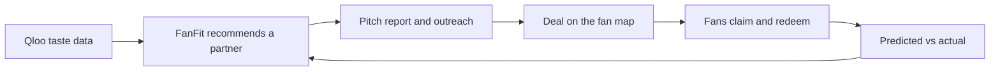

# FanFit

**Sponsorships your fans already love.** FanFit matches sports teams and brands on what fans actually like, using
[Qloo](https://qloo.com)'s cross-domain taste data, and closes the loop with deals that fans claim and redeem.

**Try it:** https://fanfit-a73p.vercel.app. No sign-up: use **Team demo**, **Sponsor demo** or **Fan demo** at the top of
the home page. Each page has a **? Guided tour**, and every score has an **ⓘ** that explains how it is calculated.
See [How to test it](#how-to-test-it) for a 10-minute path through all three sides.

---

## How to test it

Everything below runs on the live site with the shared demo accounts: no sign-up, no keys. Switch sides any time with
**Demo · switch side ▾** at the top right. Close a guided tour with **Esc**; replay it with **? Guided tour**.

### The 10-minute path

| # | Do this | You should see |
| --- | --- | --- |
| 1 | Home → **Team demo** | Seattle Sounders FC's workspace; a guided tour starts |
| 2 | **Find sponsors** → **Who to call** | Brands Sounders fans love, each with the age group that loves it most and "why now" news with sources. The analysis is saved, so it loads instantly |
| 3 | Click **ⓘ** next to *Who to call*, then open **How the agent ran** | How the ranking works; every step the agent took |
| 4 | Scroll to **Set aside**, find **Gatorade** (it clashes with Seattle's partner Powerade) → **✉ Prepare pitch** → **Create report** (~20–30 s) → **Open report ↗** | A one-page report anyone can open by link: fit, rank among 79 teams, shared fans, what both audiences love, sourced news, a matchday idea, and a category check that states the Powerade clash instead of hiding it. Any brand under *Who to call* works the same way |
| 5 | **Demo · switch side ▾** → **Sponsor · Gatorade** | All 79 teams ranked for Gatorade |
| 6 | **Target audience**: *25–29*, *Women*, *Fitness* | Every team re-scored for that audience; ▲▼ show who moved (Gotham FC and Seattle Reign jump into the top 4) |
| 7 | Untick **Hide teams with my category taken** (Seattle's drinks category is held by Powerade), open **Seattle Sounders FC** → **Tell Seattle Sounders FC you're interested** → **Create report** | Your note and its report link; the team's answer will show here |
| 8 | **Outreach** → **Received** | The pitch Seattle sent Gatorade in step 4, with its report; answer **Interested** |
| 9 | Switch to **Team** → **Outreach** | *Sent*: your pitch, how often its report was opened, Gatorade's answer. *Received*: Gatorade's note with fit and the exclusivity warning |
| 10 | Switch to **Fan** | Your teams' partners and deals on one map, ordered **For you** by the demo fan's tastes, each with "because you like …" |

### More to try

**Team**
- **✦ Ask FanFit**: tap an example ("Which banks would fit our fans best, and do any clash with our current sponsors?").
  Watch the agent pick tools on the left; every name in the answer comes from a tool.
- **By category** and **Fan mix**: drag a fan-mix slider and watch *Who to call* re-rank.
- **Local businesses** tab under *Who to call* → **+ Fan map offer** publishes a deal to the club's fan page
  (demo offers are labelled).
- **Fan offers**: claims, redemptions and **Predicted vs actual**. The *Demo* tab uses simulated claims with random ages,
  so it shows predictions only; share and lift appear on *Real* once fans claim real offers.

**Sponsor**
- **✦ Ask FanFit**: "Find three NBA teams whose fans love us and whose category is still open."
- A team page's tabs: **Audience fit**, **What fans of both love**, **Sponsors, timing & activation** (**Check sponsors and news**, **✦ Activation idea**).

**Fan**
- **Your taste** → **Edit**: switch between *Brands*, *Music*, *Movies* and *TV shows*; the suggestions are what fans of
  your teams like (Qloo). Add one and watch the order of deals change.
- Tap ♡ on another team to add it to the map; filter the map by team.
- **Get code** on a deal → a code and QR to show at the counter (demo codes are marked "not valid in store") → **My coupons**.
- **Near me** sorts every team's deals by distance; your location stays on your device.

### Good to know
- The demo accounts are shared, so you may see what earlier visitors did. They cannot change sponsor lists, approve
  members or delete data, and their notes and pitches only reach other demo accounts.
- Each note or pitch can be sent once per pair: use **Withdraw** to send it again.
- Actions that call Qloo or a web search have daily limits. **Re-run with fresh data** (about 3 minutes) is limited to a
  few runs a day for the shared team account; the saved analysis shows everything without it.

---

## The problem

Sponsorship is sold by category and decided on reach: a club pitches whoever has budget, and a brand buys the biggest
audience it can afford. Neither side knows whether *these* fans actually like *this* brand. Mid-size clubs and
local businesses, who could gain most from a well-matched partner, have the least data.

FanFit answers one question from both sides: **do these fans already love this brand?** Then it helps act on the answer.

## What each side gets

### Teams (demo: Seattle Sounders FC)
- **Find sponsors**: an agent profiles the club's fans (Qloo demographics), asks Qloo which brands and local businesses
  each age group loves around the club's city, searches the news for a reason to call each one *now*, and sets aside
  anyone already signed or in a category a current sponsor holds. Results: who to call, the best fit in each
  sponsorship category, the fan mix (adjustable), current sponsors, and every step the agent took.
- **Prepare pitch**: one click turns a recommendation into a shareable one-page report for the brand (see *Pitch reports*).
- **Ask FanFit**: give the agent a goal in plain words ("Which banks fit our fans, and do any clash with our sponsors?").
- **Fan offers**: publish a deal from a recommended local business to the club's public fan map; see claims and
  redemptions, and **Predicted vs actual**: the age group FanFit expected each business to draw, next to who claimed.
- **Our sponsors**, **Members** (approve teammates), **Outreach** (pitches sent, brand notes received).

### Sponsors (demo: Gatorade)
- **Team ranking**: all 79 NBA, MLS, WNBA and NWSL teams ranked by how much more their fans like the brand than a typical
  big brand, with category availability.
- **Target audience**: re-rank every team for an age group, gender and interest (for example women 25–29 into fitness);
  arrows show who moved. For Gatorade, that audience lifts Gotham FC and Seattle Reign (NWSL) into the top 4.
- **Team page**: fans vs customers by age and gender, what people who like both also love, shared brand traits, the
  club's sponsors, news, and a matchday activation idea.
- **Tell them you're interested**: a note to the club with a FanFit report attached; answers come back under **Outreach**.

### Fans
- Heart your teams and see all their partners and deals on one map; claim a code and show it at the counter (QR).
- **Your taste**: pick brands, music, movies and shows (Qloo suggests what fans of your teams like). Deals are then
  ordered **For you**, with the reason: "Strong match for your taste · because you like Patagonia". Tastes stay private.

### The loop



---

## Why Qloo

Qloo's taste data is what makes FanFit possible. Its strengths, and what each one does here:

| Qloo strength | What it does for FanFit | Without it |
| --- | --- | --- |
| **Cross-domain taste graph**: one entity (a team) connects to brands, artists, films, TV, places and more | From a single team, FanFit finds sponsors, local businesses for fan deals, and performers and venues for activations | Separate data for each domain, or guesswork |
| **Affinity, not popularity**: how much more people who like X like Y | "Sounders fans like REI more than they like the typical brand" instead of "REI is big" | Recommendations follow brand size, not fans |
| **Demographic signals** (age, gender) | Six age-group views per team, weighted by the real fan mix; sponsors re-rank teams for their target audience | One average fan that does not exist |
| **Location signals and real places with coordinates** | Recommendations local to the club's city; partners and deals pinned on the fan map | A list with no map and no local businesses |
| **Interest tags and descriptive tags** | Target audiences ("into fitness"), shared brand traits (Active Living, Energetic), category filters | Manual category lists |
| **Stable entity IDs and search** | The agents may only name what a Qloo call returned, which is how grounding is enforced; deals and partners join on Qloo place IDs | An LLM that can invent brands and venues |
| **Aggregate, privacy-safe insight** | Audience understanding without collecting fans' personal data; a fan's own tastes stay on their account | Surveys or tracking |
| **Scale and speed** | 40 teams scored for a brand in one request; a full club analysis in about 3 minutes | Weeks of agency research |

The result is the core idea of FanFit: **a mid-size club with no research budget gets the same audience evidence a big
league buys**, and both sides of a sponsorship can read it.

## How FanFit uses Qloo

Every team, brand, artist and place FanFit shows comes from Qloo. The language model only searches the news, classifies
and writes text, and it cannot add names of its own (see *Agents*).

| Feature | Qloo request | What it gives |
| --- | --- | --- |
| Fan profile | `/v2/insights`, `filter.type=urn:demographics`, team as `signal.interests.entities` | Age and gender skew of the club's fans |
| Who to call | `/v2/insights`, brands or places, team + `signal.demographics.age` (6 groups) + city (`signal.location.query` / `filter.location.query`) | What each age group of fans loves locally; scored by percentile and weighted by the fan mix |
| Best by category | `filter.tags=urn:tag:industry:qloo:<category>`, team + city | The top brands in each sponsorship category (banks, airlines, drinks…) |
| Team ranking | brand as signal, `filter.results.entities` = 40 teams per call | The brand's affinity with every team, as a z-score against each team's 40-brand baseline |
| Target audience | + `signal.demographics.age`, `signal.demographics.gender`, `signal.interests.tags` | The same ranking for one audience |
| Shared tastes and traits | team + brand as signals for brands, artists and places; `/entities` tags | What people who like both also love; the image both share |
| Activation idea | team + brand + the age group they share most | A performer, venue and co-partner both audiences love |
| Fan "For you" | each taste as signal, `filter.results.entities` = the fan's places | Each place's rank for each taste; the best taste becomes the "because" |
| Taste suggestions | the fan's teams as signal, `filter.popularity.min` | Popular brands, artists, movies and shows among fans of those teams |
| Search and places | `/search`, `/entities` | Teams, brands and tastes by name; place names, addresses and coordinates |

**Why these choices** (details in `src/lib/fanfit-score.ts` and `src/lib/sponsor-fit.ts`):
- Raw affinities cluster tightly and their level differs by team and age group, so FanFit compares **ranks and
  z-scores**, not raw numbers. The sponsor ranking compares each team with its own 40-brand panel (`fit_mean`, `fit_sd`
  in the seed); otherwise teams whose fans score high for every brand would top every list.
- Brands that only appear without the city signal are scored on the team signal alone, pulled toward the middle by how
  well the two signals agree on brands that have both.
- Tested on the hackathon API: age, gender and interest tags each change rankings; Qloo audience groups
  (`urn:audience:…`) were accepted but changed no result, so they are not offered.

**Quota and speed:** requests are paced (250 ms) and retried on 429, compacted responses are cached in Postgres for 30
days, full analyses are saved and replayed, and every action that spends Qloo or web searches has a daily limit
(`src/lib/usage.ts`).

---

## Agents

1. **Sponsor finder** (`src/lib/fanfit.ts`, `/api/fanfit`): a multi-step agent that streams its trace to the page:
   resolve the team in Qloo → fan profile → six age-group queries for brands and for places → category leaders → current
   sponsors (the club's list, else a web search) → sourced "why now" for the top candidates → exclusivity rules. Candidates
   the timing step never reached are still checked against the sponsor list, and the shortlist refills as signed brands
   drop out.
2. **Ask FanFit** (`src/lib/ask-agent.ts`, `/ask`): a goal-driven tool-use loop (OpenAI Responses API). It plans, picks
   its own tools, and must finish with `submit_answer`. Sponsor tools: `rank_teams` (with league, state, open-category
   and target-audience filters), `team_audience`, `shared_taste`, `team_news`. Team tools: `saved_analysis`,
   `fan_profile`, `brand_fit`, `category_leaders`, `local_businesses`, `check_conflicts`.
   **Grounding is enforced in code:** an answer is rejected if any pick was not returned by a tool, or if it presents a
   brand a tool showed to be signed or in a sold category without saying so.
3. **Pitch reports** (`src/lib/pitch-report.ts`): FanFit assembles the facts, then the model writes the headline and
   summary from those facts only, and must state a category conflict if there is one.

## Pitch reports

A one-page snapshot of why a team and a brand fit: fit and rank across all teams, audience overlap, what fans of both
love, shared traits, sourced news, a category check and a matchday idea. It opens at `/r/<token>` without sign-in (24
random characters, not indexed), prints to PDF, and counts views by readers other than the author. FanFit never sends
email itself: "Email it" opens the user's mail app with the note and link filled in. If the recipient is on FanFit, the
pitch also lands in their Outreach inbox and they can answer.

---

## Honest limits

- Fit measures **shared taste**, not sales or sponsorship outcomes. A backtest against public MLS sponsor renewals was
  inconclusive, so FanFit positions itself as decision support; the claims-and-redemptions loop is how real results
  get measured.
- Women's league teams have thinner Qloo data; their scores are rougher (noted in the ranking).
- Sponsor lists found by web search can miss deals; clubs can keep their own list on FanFit.
- Demo data is labelled: demo offers were not agreed with the businesses, simulated claims pick ages at random (so the
  Demo tab hides lift), and demo outreach only reaches demo accounts.

## Security and privacy

- Supabase row level security on every table, column-level grants where users may edit only some fields, and
  security-definer functions for cross-role reads. `npm run db:check` runs **135** checks against a local database.
- Team accounts need approval by a teammate or an admin before they can edit club data.
- Scores in outreach and reports are written by the server with the secret key, so they cannot be forged.
- Shared demo accounts cannot change sponsor lists, approve members or wipe data; offers they create are always demo offers.
- A fan's tastes are visible only to that fan. Location for "Near me" never leaves the device.

## Architecture

```
src/
  app/                      Next.js 16 App Router pages and API routes
    fanfit/                 team: Find sponsors (console, offers, activation)
    sponsor/                sponsor: ranking, target audience, team pages, outreach
    team/                   team: sponsors list, offers dashboard, members, outreach
    (fan)/                  fan: home, map, near me, coupons, account, team fan pages /t/[id]
    ask/                    Ask FanFit
    r/[token]/              public pitch report
    api/                    fanfit, ask, pitch, sponsor/team-check, fanfit/activation, health
  lib/
    qloo.ts, qloo-cache.ts  Qloo client: pacing, retries, compaction, Postgres cache
    fanfit.ts               sponsor-finder pipeline, sponsor lists, news and timing (OpenAI web search)
    fanfit-score.ts         percentile scoring, fan-mix weights, categories, exclusivity rules
    sponsor-fit.ts          team ranking (z-scores), targeted ranking
    sponsor-detail.ts       audiences, shared tastes and traits, team news
    fanfit-activation.ts    activation ideas
    ask-agent.ts            Ask FanFit tool-use agent
    pitch-report.ts         pitch reports
    fan-taste.ts            fan tastes, suggestions and "For you"
    audience.ts             target audience (age, gender, interest)
supabase/migrations/        schema, RLS, functions (17 migrations)
supabase/seed.sql           79 teams with Qloo IDs and 40-brand baselines
scripts/db-check.mts        row-level-security test suite
```

**Stack:** Next.js 16 (App Router; `src/proxy.ts` is the middleware), React 19, Tailwind CSS 4, Supabase (Auth,
Postgres, RLS), Qloo Insights API, OpenAI Responses API with web search, Leaflet + OpenStreetMap, driver.js for the
guided tours. Hosted on Vercel; a daily cron pings `/api/health` so the free database does not pause.

## Run it locally

```bash
npm install
cp .env.example .env.local          # QLOO_API_KEY, OPENAI_API_KEY; Supabase values from the next step
npx supabase start                  # needs Docker; prints the local URL, publishable key and secret key
npx supabase db reset               # applies the migrations and seeds the 79 teams
npm run dev
```

Sign-in emails go to the local Mailpit inbox at http://127.0.0.1:54324. Set `DEMO_PASSWORD` to any long random string
to enable the one-click demo accounts.

| Script | What it does |
| --- | --- |
| `npm run dev` / `npm run build` | Develop / production build |
| `npm run db:check` | 135 row-level-security checks against local Supabase (creates throwaway users) |
| `npm run fanfit -- "Austin FC" "Austin, TX"` | Runs the sponsor-finder pipeline in the terminal |

Environment variables are documented in `.env.example`. `LIVE_RUNS_DISABLED=true` switches off every route that spends
Qloo or OpenAI calls; saved results keep working.

## License

MIT, see [LICENSE](LICENSE).
